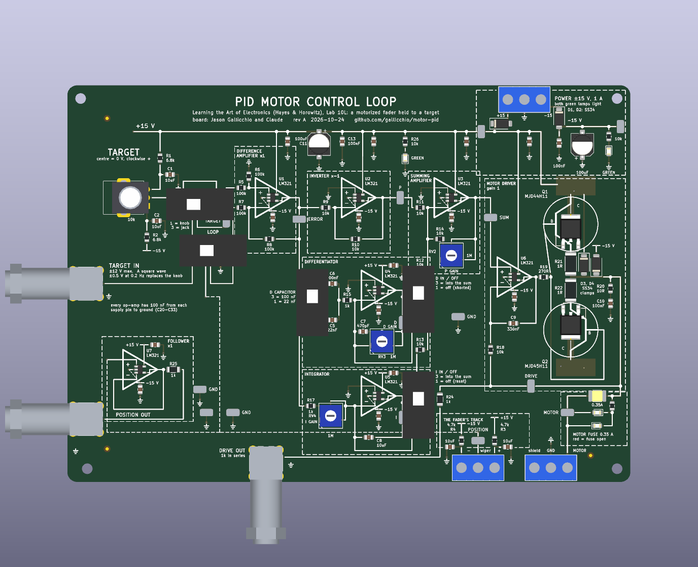
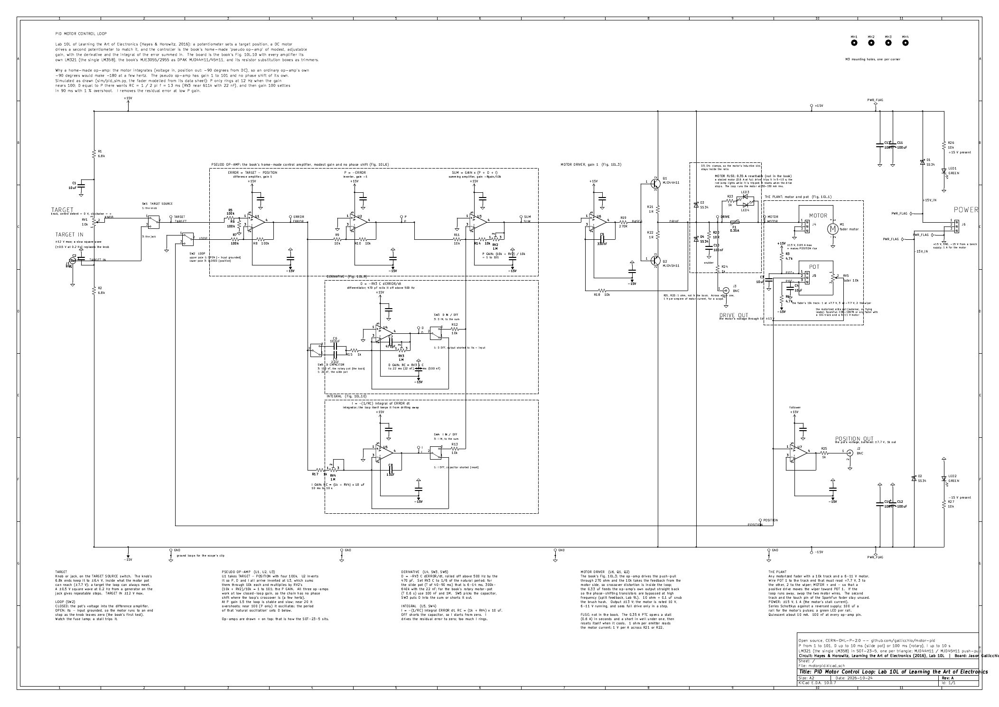
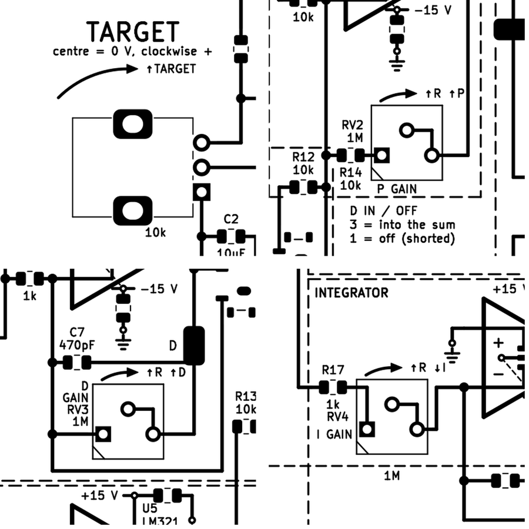
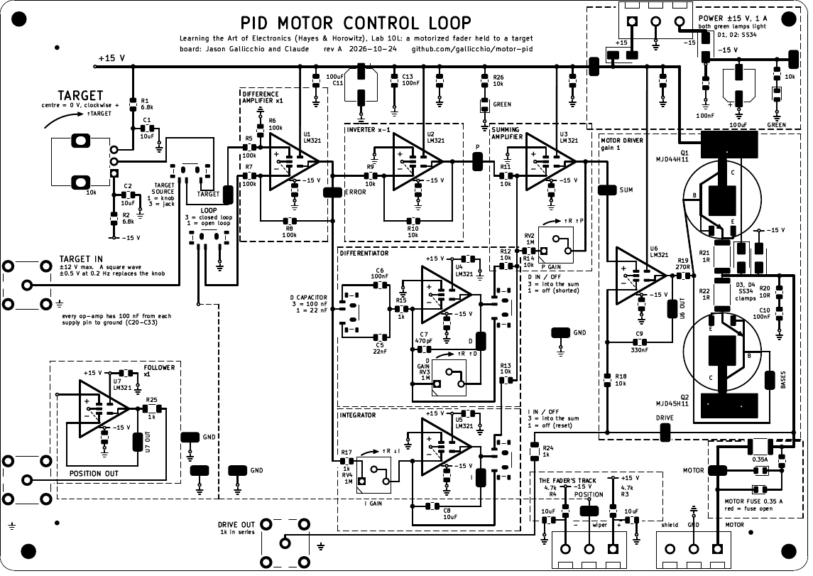
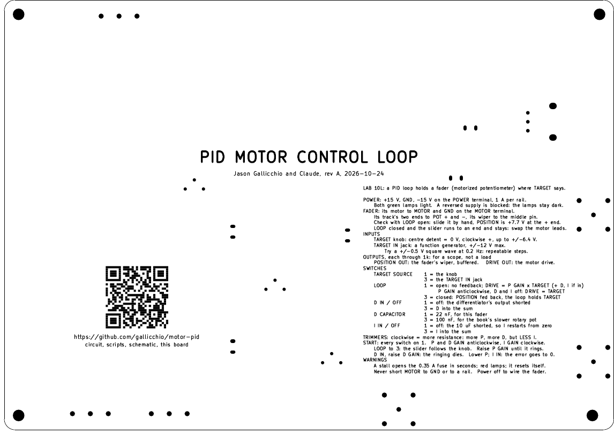

# Claude Code Chat Log — Motor PID Educational PCB (Lab 10L)

Every prompt, verbatim (minor typos fixed), followed by the response as it was given, with the
renders as they were at the time (kept under `docs/history/`).  Model: Claude Fable 5.1.

## Prompt 1

> Similar in spirit to the project in `../op-amp-pcb`, I want you to design a schematic and PCB for Lab 10L.
>
> The motor+potentiometer combination that we have was from Sparkfun, item COM-10976, "Slide Pot - Motorized (10k Linear Taper)". I don't know if they sell these any longer, but they seemed commonly available.

## Prompt 2

Sent while the first response was being built:

> As usual, log all prompts and response in CLAUDE_CODE_CHAT and to look at CLAUDE_PCB.md and add anything relevant that you learn there.

## Response 1

*2026-10-24 17:42 PDT through the early hours of 2026-10-25 PDT.*  Prompt 2 arrived while
this was being built and is folded in: this log, and the lessons added to `CLAUDE_PCB.md`.

### What was built

A complete, script-generated KiCad 10 project in the style of `../op-amp-pcb`:

- `scripts/parts.py` — the parts table (JLCPCB codes, prices, stock on 2026-10-24,
  footprints, the per-code JLCPCB rotation **and datum shift** table).
- `scripts/gen_sch.py` — the A2 sheet: TARGET, the pseudo op-amp (difference amplifier,
  inverter, summing amplifier), the differentiator, the integrator, the motor driver, the
  plant's terminals, power.  ERC 0, no text overlaps.
- `scripts/check_circuit.py` — 243 assertions on the exported netlist (every stage's
  wiring and values, switch poles, diode polarities, the D rule's reach, no shorted part,
  no one-pin net).
- `sim/pid_sim.py` — ngspice on the exported netlist with behavioural LM321, DPAK and
  fader models: P sweep, the natural frequency, D by the lab's rule, I, stall, short, a 10 V
  step.  `sim/results.json`, `docs/images/sim-*.png`.
- `scripts/layout.py` + `scripts/gen_pcb.py` — the 170 x 120 mm board, every wire laid as
  copper and drawn as silkscreen, DRC 0 with schematic parity.
- `scripts/gen_outputs.py`, `check_outputs.py`, `gen_docs.py` — gerbers, BOM, CPL (native
  and JLCPCB-corrected, with datum shifts), prints, renders, STEP; the fab checks; the
  generated `docs/MANUFACTURING.md`, order form and `PLACEMENT_CHECKS.txt`; the claims check
  on the hand-written documents.
- `README.md`, `docs/HANDBOOK.md`, `docs/DESIGN_NOTES.md`.

### The fader

SparkFun COM-10976 is the TOP-UP MD100AM2B-D (datasheet in `datasheets/`): 100 mm travel,
two 10k linear tracks and a touch track, a 10 V motor (6–11 V, 400–800 mA stall,
200 mm/s).  Its side tabs do not fit a board; it hangs off two 3-way screw terminals (MOTOR
+, GND, shield; POT +, wiper, −) on flying leads, so any 100 mm fader with a 10k track works.

### Decisions, and why

| decision | why |
|---|---|
| LM321 singles (SOT-23-5) for all seven op-amps | the lab says "not 411" for the driver; one type; a single per triangle lets the silkscreen draw each op-amp as its symbol.  Its + input is pin 1, so every triangle is drawn + on top |
| MJD44H11 / MJD45H11 DPAK push-pull on pours | surface-mount so JLCPCB places them; 8 A parts shrug off a stall for the seconds the fuse allows |
| 1 Ω emitter resistors (2512) | current sharing, and 1 V/A for a scope.  An output current limiter (Q3/Q4 + steering diodes) was designed, simulated (0.65 A) and then **removed**: the fuse covers the stall, and the limiter made the push-pull impossible to draw cleanly |
| 0.35 A PTC in the MOTOR line, red LEDs across it | a stall is 0.60 A at 9.1 V (3.1 W in one DPAK); the 0.5 A part would not trip; 0.35 A trips in seconds and resets.  A dead short is 2.0 A / 29 W until it trips: listed as a risk |
| D capacitor switchable 22 nF / 100 nF | the loop rings near 12 Hz at full P; the lab's RC = 1/2πf is 13 ms, which with 22 nF puts the trimmer two thirds up (611k) and with the book's 100 nF at the bottom.  Started at 10 nF; moved to 22 nF so the rule lands mid-dial |
| 1M 3362P trimmers for P, D, I | JLCPCB stocks no 1M shafted pot; trimmers are keyed by their holes |
| ALPS RK09K centre-detent knob for TARGET, pin 3 at the + end | clockwise = positive; the pin order was flipped on the sheet once the ALPS drawing was read |
| D IN/OFF and I IN/OFF: pole 3 = into the sum, pole 1 = off; the D capacitor switch sits *before* its two capacitors | the MSK12C02 has all three pins on one edge; the common pin in the middle is trapped unless its two neighbours leave in opposite directions.  Putting the sum on the top pole and the short on the bottom one, and the ERROR into the capacitor switch's common, lets every switch wire leave straight |
| −15 V as a per-op-amp flag on the back | V− is pin 2, between the two inputs; no front copper can leave the triangle there.  A via inside each triangle, a back trunk under the +15 V rail, a flag and a bypass under each triangle, as the sheet's power symbols |
| POSITION back to the LOOP switch on the back, drawn dashed | the only wire that would otherwise cross every stage |
| 170 x 120 mm | the first floorplan at 160 x 110 could not stack the D and I stages' feedback rows above the bottom-edge terminals |

### What the simulation says (fader model estimated, not measured)

| case | result |
|---|---|
| quiescent | 4 mA, every node at zero |
| P only, 1 V step | gain 1.5: 46 % short; gain 5: 89 mV residual; gain 22: 12 % overshoot; gain 100: rings at 11.8 Hz |
| P 22 + D by the rule (RV3 611k) | 3.8 % overshoot |
| P 100 + D | 1 % overshoot, settles in 90 ms |
| P 5 + I (RV4 100k) | the residual walks through zero in about a second, then hunts slowly; RV4 5k oscillates |
| stall (end stop, loop open) | 0.60 A, 9.1 V across the motor, 3.1 W in Q1 |
| MOTOR shorted to ground | 2.0 A, 29 W in Q1 until the PTC opens |
| 10 V step, P 22 + D | 1.15 A peak, 13.3 V drive peak |

### Things that went wrong on the way (and are now rules or checks)

- A BNC placed on the knob's wire column grounded the knob's bottom end through its
  shield: C2 ended up with both pins on ground.  Found by reading the nets; now
  `check_circuit.py` asserts no two-pin part is shorted and the knob's ends are their own
  nodes.
- ngspice's `limit(x, lo, hi)` is a Monte-Carlo *random* function, not a clamp; the
  op-amp model returned 0.  `min(max())` instead.
- "+15V" and "−15V" both sanitise to the same SPICE node name unless the sign is spelled.
- KiCad's symbol coordinates have y up: the SW_SPDT's pin 1 is the *upper* right pin, so
  "mirror x" was needed to put pole 3 on top as the board wants it.
- The DPAK: KiCad's TO-252 has the base and emitter pads 2 mm below the tab, so a
  45-degree emitter leg cannot pass between them; the symbol's legs leave at 33 degrees,
  and the circle is centred 1.5 mm toward the tab.  The 'silk clipped by solder mask'
  warning that pointed at the tab was the leg grazing the tab's corner, found by deleting
  symbol pieces one at a time.
- A closed loop of back-layer runs (−15 V branches plus the +15 V spine) isolated a patch
  of ground plane with a bypass via in it; `gen_pcb.py` now checks every ground via is
  inside the filled plane.
- The AppImage ships no 3D model for the MSK12C02, the RK09K or the 1812 fuse; stand-in
  bodies are generated and swapped in, so the render shows parts and the model check passes.

### Not yet proven (also in DESIGN_NOTES)

1. Which slider position of the MSK12C02 closes which contact (the datasheet draws the
   circuit, not the travel).  The legends assume the slider toward pin 1 connects pin 1.
2. A dead short of MOTOR to ground: 2 A for under a second.
3. The fader model's constants.
4. The predicted JLCPCB rotations and datums (SOT-23-5, DPAK, slide switch, knob, trimmers).
5. The PTC's trip time at a 0.6 A stall.
6. The knob's turn direction (pin 3 = clockwise end).

### Numbers

170 x 120 mm, 102 placements, 45 BOM lines, 12 Extended codes, $9.96 in parts per board,
197 SMT and 27 through-hole joints, 66 vias, 15 probe loops.  `./make.py` runs every stage
and check from scratch.

## Prompts 3 and 4

Sent while Response 1 was being built, after context resets:

> keep going

> Keep going, but keep this chat updated as to your progress.

## Prompt 5

> Explain more what you changed: "The D and I switches now put pole 3 into the sum and pole 1 off, and the D capacitor switch sits ahead of its two capacitors, so each slide switch's wires leave its one-sided pins without crossing."
>
> Then explicitly ask again the things you need my input on.

## Response 2

*2026-10-25 PDT.*

### The switch and why it dictates the wiring

The MSK12C02 has its three terminals in a row along one edge of the body: pin 1, then
the common pin 2, then pin 3 (the common sits nearer pin 3).  On this board every slide
switch is turned so that row is a vertical column on its west face.  Copper follows the
drawn silkscreen on the front layer, with no second-layer escapes except the deliberate
back runs, so from a column of three pads the only crossing-free pattern is: top pad goes
up, middle pad goes straight out west, bottom pad goes down.  Whatever arrives from the
west must land on the common, and whatever has to head up toward the summing amplifier
(which sits on the row above the D and I stages) must be on the top pad.  The first draft
had the poles the other way round, so the "to the sum" wire left the bottom pad and had to
climb past the other two.

### SW3 and SW4 (D IN / OFF, I IN / OFF)

Before: pole 1 fed the 10 k into the sum; pole 3 shorted the stage (D: output to its
− input; I: across the 10 µF).  Now: pole 3 is the top pad and goes up through R12 (R13)
into the sum; pole 1 is the bottom pad and goes down to the feedback return row and back
to the − input; the op-amp's output comes in from the west straight into the common.
Electrically nothing changed: the same two states with the same parts, only which pin
number does which.  In the schematic KiCad's SW_SPDT symbol is drawn mirrored vertically
so pin 3 is the upper throw, matching the board.

### SW5 (D CAPACITOR)

Before: the 22 nF and the 100 nF sat between ERROR and the two poles, and the common went
on through R15 (1 k) into U4's − input.  That makes the common the one wire that must get
east past the switch body while both poles are fed from the west.  Now ERROR goes into the
common from the west, pole 3 goes up and east to the 100 nF, pole 1 goes down and east to
the 22 nF, and the two capacitors' far ends join and feed R15 together.  For the selected
capacitor the path ERROR → C → 1 k → virtual ground is identical.  The unselected capacitor
has one end on an open pole in both versions, and flipping the switch gives the same small
kick into the differentiator either way.

The "3: … / 1: …" legends beside each switch, the handbook's set-up table, the netlist
checks and the simulation's default switch states all follow the new assignment.  Which
physical slider end is "3" remains item 1 of the unverified list.

### Questions, each with the default I will take if unanswered

1. **Slide switch travel.**  Is there an MSK12C02 (or the Sparkfun switch you would use)
   on hand to check which slider end closes pin 1?  Default: leave the legends, verify on
   the first board; nothing is damaged if it is backwards, the words just swap.
2. **Protection.**  I removed the active current limiter; the board relies on the 0.35 A
   PTC with the 1 Ω emitter resistors as sense.  A dead short of MOTOR to ground is about
   2 A through one DPAK for the PTC's trip time.  Keep that, or put the limiter back
   (two small transistors, two diodes, some board)?  Default: keep the PTC only.
3. **Fader measurements.**  The model assumes 15 Ω winding, 0.67 A stall at 10 V, 50 mA
   free-running.  Three bench numbers would pin it and confirm the 0.35 A PTC: winding
   resistance, free-running current at 5 V, and traverse time at 5 V.  Can you measure, or
   keep the estimates and tune on the bench?  Default: estimates.
4. **Board size.**  170 x 120 mm, against the op-amp board's 100 x 100.  Five bare boards
   are $14, ten are $24; assembled, $28 each at five and $21 each at ten.  Fine, or should
   it shrink (tighter layout, fewer probe loops, smaller text)?  Default: keep it.
5. **Next step.**  A design-review round first, like the op-amp board's `design_reviews/`,
   or straight to ordering?  How many assembled?  Who does the JLCPCB upload: I can drive
   the browser and check the placement preview (unverified item 4), or you upload and send
   screenshots.  Default: wait for your answer.
6. **Minor.**  The knob's clockwise end is assumed from the ALPS drawing (pin 3 = +).  Say
   if you care which way is +.

## Prompt 6

With the MSK12C02 data sheet's section drawing attached (handle 3 on top, moving
contact 4 and spring 5 over the three terminals):

> 1. I do not have an MSK12C02 on hand, but from the diagram that I've attached from the data sheet, it looks like the position of the slider handle mechanically pushes down metal onto the pin on that same side. Presumably that metal is also attached to the middle.
>
> 2. If the fuse is re-settable after being off for some thermal delay, keep the fuse as the protection.
> 3. Remind me again and I can make the measurements tomorrow in lab.
> 4. Keep the big size for this much bigger circuit. I'd rather keep the ability to probe than save a few dollars. Not every student needs one of these boards, whereas every student needs an op-amp board.
> 5. I will look over the schematic and PCB today or tomorrow and comment. After you make those changes, we will do a design review.
> 6. I'm torn. I generally do want clockwise "screwing in" to increase the resistance. Sometimes that corresponds to decreasing the relevant gain, which might be counter-intuitive. It would be best to have a little arc over the top of the knob with an arrow on the increasing/clockwise side that is labeled "↑R ↓P" or whatever is appropriate for that particular knob.

## Response 3

*2026-10-25 PDT, afternoon.*  All six answers acted on; the build passes end to end
(ERC 0, 246 circuit checks, DRC 0, fab checks, 23 document claims).

### What changed on the board

- **Clockwise arcs.**  Each trimmer and the knob has a short arc over its top ending in an
  arrowhead at 12 o'clock, labelled with what clockwise does: "↑R ↑P", "↑R ↑D", "↑R ↓I"
  and "↑TARGET".  Bourns' 3362 data sheet marks terminal 3 as the clockwise end, and all
  three trimmers are rheostats between pins 1 and 2 with 3 tied to the wiper, so clockwise
  is always more resistance.  A new circuit check asserts that wiring; `gen_pcb.py` refuses
  an arc that comes within 0.5 mm of a drawn wire (DRC does not mind ink over ink).  KiCad's
  stroke font has ↑ and ↓, so the labels are ordinary silk text.
- **Room for the arcs.**  Each trimmer's wiper tie to pin 3 now runs under the part body
  (the one wire on the board a part hides) so the top of the trimmer is clear.  The P
  trimmer moved right 1 mm with its 10 k fed from the side on the pin row; the D stage's
  feedback row went up 1 mm and its return row down 0.5 mm, and the D trimmer moved down
  2 mm; the I stage's + input ground via moved 0.8 mm right.  The arcs are radius 5 from
  238°: a 10 o'clock start lands on the wire feeding terminal 1, and any lower start
  overlaps the trimmer's own silk box.
- **Handbook fix.**  The set-up table said to turn all three trimmers fully anticlockwise
  for lowest gain.  For I that is backwards: anticlockwise is least resistance and most I
  gain.  Now: P and D anticlockwise, I clockwise; the I exercise says "anticlockwise: less
  resistance is more I".  The schematic carries the same note beside each trimmer's formula.
- **Design notes.**  Jason's reading of the MSK12C02 section is item 1 (slider toward pin 1
  closes pin 1; still an ohmmeter check on the first board).  The fuse stays as the only
  protection.  The board size and the reason for it are recorded.  The knob's clockwise end
  is still the Bourns/industry convention; the ALPS sheet could not be fetched.

### For the lab on 2026-10-26 (also in DESIGN_NOTES, "Measurements to make on the fader")

1. Winding resistance: ohmmeter across the motor leads at several slider positions; take
   the lowest few.
2. At 5 V from a bench supply: the current while it runs freely, the time end to end, and
   which polarity moves the slider toward the + end of the track.
3. Stall current at 5 V holding the slider for a second, and the lowest voltage at which it
   starts to move from rest.
4. The track: end-to-end resistance, and a scope on the wiper while the slider is pushed
   slowly with 10 V across the track, looking for dropouts.

They go into the constants at the top of `sim/pid_sim.py`; the handbook's ringing gain and
D trimmer position follow from the rerun.

### Elsewhere

Lessons into `~/OpticsPCBs/CLAUDE_PCB.md` (committed as its own hunk; another session's
uncommitted section-17 edits left as they were).  Next: Jason's read of the schematic and
board, those changes, then the design-review round.

## Prompt 7

> The target should be able to be overridden with a function generator input on a BNC input. If the target potentiometer has reasonable resistors between each extreme and +-15V, a function generator should be able to be plugged in directly onto the center tap to "override" the potentiometer and input a square, triangle, sawtooth, or sine wave. If this is not already there, add it.

## Response 4

*2026-10-25 PDT.*  Already there, as a switch rather than a direct tap; no change made.
J1 (TARGET IN, BNC, shell grounded) goes to pole 3 of SW1 (TARGET SOURCE); the knob's
wiper goes to pole 1; the common is TARGET, which feeds U1's 100k input.  Silk beside
the jack: "±12 V max.  A square wave ±0.5 V at 0.2 Hz replaces the knob".  Handbook
section "The square wave" uses it.  The switch was kept over a direct tap because the
generator then sees only the 100k input, with no knob-position offset (a direct tap
would see the wiper's 2.5–5.9 kΩ, about 1–2 % loading and up to ~50 mV of offset
from the knob with a 50 Ω generator; workable, and Jason's call if he prefers it).

## Prompt 8

> No, your switch is great. Keep it. If you didn't already have it, I was suggesting something that would need fewer changes.

## Response 5

Kept as is.  No change.

## Prompt 9

> Would a log pot feel more natural for tuning than linear pots?
>
> Students should be able to break the feedback loop and drive the MOTOR DRIVER directly from the input potentiometer or function generator. This can be a switch that selects the motor driver input between the output of the SUM (in normal feedback mode) and whatever is selected as TARGET.
>
> I don't understand the function of SW2 LOOP. Explain that. At a minimum, the description in the schematic under the text "SW2 LOOP" is not helpful and needs to be improved.
>
> There need to be probe points to look at D and I in addition to what's already there. (Going into a 1M or 10M oscilloscope should be fine.) There should also be a test clip for the motor DRIVE and one on "BASES" to see the interesting thing that the op-amp needs to do when the input crosses zero and it suddenly needs to jump around 1.2 or 1.4 V to go from turning on the NPN's diode to turning on the PNP's diode. If there is room to put more test clips, especially at the outputs of the other opamps, do that.
>
> The ground symbol next to the "up R down I" text is too close to the I. Move it a bit east. The font for "I" does not have the top and bottom bars, so it needs to be pretty clear and isolated so that it's not mistaken for a vertical bar.
>
> On the back silkscreen:
>
> the github address in the text should include the "https://" bit the QR code is fine as is.
>
> The word "fader" is not something we use in class. When you first mention it, say "fader (motorized potentiometer)".
>
> There is a lot of room on the back. When you talk about switches or other things, put each option on its own line. You can allow the text column to be wider, especially if it means keeping ideas on their own lines. The silkscreen can overlap the traces. You can even move the QR code to the west and make more room for more text. Making the text column wider might violate my suggestion about not making text columns too wide, but I'd pay that price if each item can be on its own line, somewhat like a bulleted list. Students will *not* read the documentation in the README.md, but they might read this silkscreen, so take advantage of that and include relevant information about inputs, outputs, and switches, along with any warnings here. You don't need to say the line about "PROBE LOOPS" – that's obvious from looking at the front.

## Response 6

*2026-10-25 PDT.*  Build passes end to end (ERC 0, 249 circuit checks, DRC 0, fab checks,
23 document claims).

- **LOOP explained, and it already is the open-loop drive.**  LOOP picks what U1 subtracts
  from TARGET: POSITION (3, closed) or ground (1, open).  Open, ERROR = TARGET, so
  DRIVE = P GAIN × TARGET (plus D and I of TARGET if in); with P GAIN fully anticlockwise
  (gain 1) and D, I off, DRIVE = TARGET exactly.  So no separate DRIVE FROM switch was added;
  one would need TARGET carried ~80 mm across the board on the back, past the summing
  stage, and would duplicate this.  Offered if still wanted.  The schematic's SW2 text, its
  note block, the front legend ("3 = closed loop / 1 = open loop"), the back and the
  handbook now say this.
- **Probe loops.**  D (TP4) and I (TP5) and DRIVE (TP7) were already there.  Added BASES
  (TP12, on the bases wire right of Q2), U6 OUT (TP13) and U7 OUT (TP14): every op-amp output
  now has a loop.  18 loops.
- **Ground by "↑R ↓I".**  The I trimmer and R17 moved 0.8 and 0.5 mm west, the ground 0.25
  mm east (as far as U5's triangle allows): about 1 mm clear of the I.  "I GAIN" moved under
  the trimmer so no lone I sits beside a line.
- **Back.**  Rewritten as a one-item-per-line reference: power, the fader (motorized
  potentiometer) wiring and its check, inputs, outputs, each switch with each position on its
  own line, the trimmers' direction, a start sequence, warnings.  Column 57 mm wide, two
  columns for the switch options; QR moved to the other side; URL with https://.
- **Log pots.**  Answered below: yes for P and especially I, but no log trimmers exist in
  this package; the useful I range sits in the first 10 % of the 1M trimmer.

## Prompt 10

> Do the log-pot stock check. I'll go in and tune one up with my breadboarded version and measure the pots to know what a good "center of the range" should be. I want students to be able to go too far in either direction to see what happens, but I don't want even "too far in either direction" to only take up less than 10% of the range.

## Response 7

*2026-10-25 PDT.*  JLCPCB has no log pot in stock in any value, and no shaft pot above
50k at all.  Log trimmers do not exist in the 3362 size.  Bourns PTV09A (9 mm) comes in
audio taper up to 1M, but would be hand-soldered and its stock is unconfirmed.  With a
linear trimmer plus a series resistor, reaching k× too far each way puts the good point at
1/(k+1) of the turn, so linear meets the 10 % rule only for about k ≤ 3.  Waiting on the
breadboard measurements (R at sluggish / right / too much for P, D, I).  Recorded in
DESIGN_NOTES under "The trimmers' ranges".

## Prompt 11

> Our slider pots are:
> PSM01-082A-103B2
> We also have PSP01-082A-103B2, which may just have a different metal housing
> I have added datasheets: bourns_psm_slider_pot.pdf and bourns_psp_slider_pot.pdf
> With a multimeter, I measured the motor coil as 18 ohms.
> With 5V power, the stall current was 0.36 A at the end of the range (corresponding to 14 ohms). At 5V, the motor moves to the end in under a second, so it's hard to measure.
> It takes between 2 and 3 V to get the motor and slider unstuck, and to go across without getting stuck again.
> When it's moving at 3V, it draws about 0.16 A free running (19 ohms). If the voltage was any higher, it went too fast to measure the current.
> The potentiometer goes from 0 to 10k. There are occasional drop outs of infinite resistance, but as long as it moves a tiny bit, things come back.
> I often test the motor with a square wave +/-3V or +/-4V.
> With this square wave test, the 1 MOhm knobs did make the response go from too sluggish to too aggressive, so stick with 1 MOhm. The perfect value wasn't in the center of the range, but I didn't feel like all of the action was completely crammed onto one side of the range.
> The other test I like to do is with a slow sine or triangle wave, where you see a lot more of the stick-slip behavior. The best settings for the square wave were not the same as the best settings for a nice, smooth, slow triangle wave, but this all seems to have more to do with the sticky and friction-filled mechanics of the belt and slider mechanism. This is not an ideal plant, but maybe that's not a bad thing for this "real world" application.

## Response 8

*2026-10-26 PDT.*
- **The fader.**  PSM01-082A-103B2 decodes as 100 mm travel, 8.2 mm lever, snap-in
  connectors (2-pin motor B A, 7-pin 3' 2' 1' T 1 2 3, 2.5 mm pitch), metal lever, 10k,
  taper B2.  The PSP is the same motor and tracks with one 10-pin connector.  Bourns'
  drawing: A positive moves the lever toward terminal 1, so A to MOTOR, B to GND, 1-2-3 to
  POT 1-2-3: the numbers match.  The SparkFun/TOP-UP references are gone everywhere.
- **Taper B2** (read from the chart's vector paths): linear from 10.5 % to 90.5 % of the
  travel, flat outside, so the last ~10 mm each way reads the end voltage.  The servo track
  (1' 2' 3') is linear to 2 mm of each end, resistance unstated: if it measures 10k it is
  the better track.
- **The model.**  14 Ω (the ohmmeter's 18 Ω is brush film), 0.15 A sliding friction rising to
  0.18 A to break loose below 5 mm/s, 0.8 s end to end at 5 V.  P 1.5 no longer moves a 1 V
  step; P 100 rings at 31 Hz until friction stops it, then hunts.  The D rule moved from
  611k to 234k with 22 nF (a quarter of the turn), so 22 nF stays the right default.  A new
  ±3 V, 0.05 Hz triangle run shows the stick-slip (sim-triangle.png): steps of 0.04 V at
  P 22, a 0.15 V staircase at P 5 + I.  Settling is now to 5 %.
- **1M trimmers kept**; the log/linear question closed.
- **Found: a stall at a few volts cooks the driver.**  A stalled 14 Ω motor draws
  DRIVE/14 Ω; at 2-7 V that is 0.14-0.49 A, which the 0.35 A fuse holds, and the transistor
  takes 1.8-3.7 W on a pour good for about 70 °C/W.  LOOP open with P GAIN at 1 (DRIVE =
  TARGET) does exactly this.  Warnings added to the back, handbook and schematic; the fix
  (TO-220s on heatsinks recommended) is Jason's call.
- **Dropouts**: POSITION has no capacitor; a lifted wiper leaves it on U1's 100k at
  TARGET/2, a twitch that the movement itself cures.  Nothing added.
- Back silk: fader pins, ±3 V square and triangle tests, the stall warning.  Build: ERC 0,
  DRC 0, 249 checks, 25 of 25 claims.

## Prompt 12

> I like the idea of not having to solder anything and not having to attach heat sinks, but if you think TO-220's are the way to go, use the ones that we already have in the lab, which the lab manual suggests. Go a bit more into the pros and cons of each approach: the best surface-mount option vs the TO-220's from the manual, hand soldered, with screw-on heat sinks.

## Response 9

*2026-10-26 PDT.*  A board thermal model (`sim/thermal.py`: two copper sheets, the FR4 between,
the ground plane under everything, both faces cooling; it reproduces TI's 26 °C/W for a DDPAK
on a square inch of 1 oz) at the worst stall, 3.7 W sustained:
- today's DPAK on its small pour: junction 241 °C, so it would die;
- the best surface-mount option, MJB44H11T4G / MJB45H11T4G (D2PAK, the same family, both
  stocked at JLCPCB) on 28 x 30 mm pours with 2 oz copper: junction about 110 °C, the board
  round it 80-90 °C; 1 oz copper is not enough (151 °C);
- the lab's MJE3055T / MJE2955T on screw-on heatsinks: junction 83-88 °C with a 13.6 °C/W
  heatsink (the heatsink itself 75 °C), about 50 °C with a 4.4 °C/W one.
Surface mount: no hand work, nothing bare at the rail voltage, but less margin, a hot patch
of board, 2 oz copper at extra cost.  TO-220: cooler and the book's parts, but six joints
and two heatsinks per board by hand, and each heatsink is bare collector metal at ±15 V among
the probe loops unless insulated.  Recommended the D2PAKs on 2 oz; waiting on Jason's
choice.  The comparison is in DESIGN_NOTES under "A stall at a few volts".

## Prompt 13

> D2PAK on 2 oz copper.

> (mid-turn) When you are done, write the design review prompt for other LLMs like you did for the op amp board and do the top to bottom design review yourself. Encourage everyone to find problems at all levels, from implementing the spirit of it down to the PCB working.

## Response 10

*2026-10-26 PDT.*

**D2PAK on 2 oz copper, done (7e6bd49):**
- **The parts.**  MJB44H11T4G / MJB45H11T4G (C233689, C154570), KiCad's TO-263-2, JLCPCB's
  drawing turned 180° with the datum 2.45 mm toward the leads (predicted).
- **The symbol.**  Each D2PAK's symbol is a circle round its two leads, capped by the tab
  (the tab is too big to draw round).
- **The pours.**  They fill the MOTOR DRIVER box round each tab: Q1 836 mm², Q2 670 mm².
  R21 and R22 stand in two columns; D3 and D4 each have their rail end inside that rail's
  pour; the snubber moved into the pocket under DRIVE.
- **One hop.**  BASES crosses Q2's emitter wire on the back: the mirrored PNP makes that
  crossing unavoidable.
- **The plane.**  Back runs moved off the plane under the pours (Q2's −15 V now comes up the
  board's edge).
- **2 oz.**  0.21 mm rules, a 2 oz stackup in the board file (the job file says 0.07 mm), the
  order form says 2 oz, bare boards costed at ×1.5.
- **The heat, checked on the board as built.**  `sim/thermal.py --board` runs the model on
  the filled pours and the plane with its cuts: junctions 120 and 122 °C in the worst stall;
  the build fails above 125 °C.
- **A guard in the simulation.**  The sim now refuses a transistor it has no model for (a
  stale netlist had quietly simulated the wrong part).
- **Docs.**  Updated, with 5 new build-checked claims.
- **Lessons.**  Added to CLAUDE_PCB.md (69f0fde).

**Design review round 1:**
- **The brief.**  `design_reviews/DESIGN_REVIEW_PROMPT.md` (52b99ea), in the op-amp board's
  format, asks for problems at every level, from the lab's intent to the copper.
- **My own review.**  `design_reviews/2026-10-26_Claude-Opus-5.5/REPORT.md`, written after
  reading Lab 10L in the book.  Verdict: order after two fixes.
  1. No "1" / "3" is printed at the ends of the five slide switches, while every legend, the
     back and the handbook set them by number.
  2. The DRIVE probe loop is ahead of the fuse: a scope ground clip there is an unfused
     short, 2.3 A, 28 W in Q1 and 5 W in R21.
- **Minor findings:**
  - flat on a bench the junctions reach 128–130 °C, so the board wants standoffs;
  - the integrator's 10 µF X5R loses capacitance under DC bias;
  - one via carries all of Q2's current;
  - at gain 22 with D, the "10.9 % overshoot" is the friction's dead band;
  - the front's TARGET IN legend says ±0.5 V (the book's) where the back says ±3 V;
  - three wrong rows in the handbook's table;
  - no recipe for measuring the gains;
  - the I exercise sits at 4 % of the P trimmer.
- **The patch.**  `patch_round1.diff` fixes the silk and doc items, adds the DRIVE warnings and
  the extra vias, and builds clean in the review's copy.  Not applied: Jason decides, as with
  the op-amp board.  Moving the fuse ahead of DRIVE is his call.

## Prompt 14

> Yes, apply the patch. No other LLMs have reviewed it yet, and they should review the version that you've patched. And yes, move the fuse and yes change the capacitor to one more appropriate for filter work.

## Response 11

*2026-10-26 PDT.*

**The patch.**  `patch_round1.diff` applied as it stood:
- "1" and "3" at the ends of every slide switch;
- three vias at each end of Q2's −15 V edge run;
- the TARGET IN legend at ±3 V;
- standoffs in the handbook;
- the handbook's table, the "measure your gains" recipe and the I exercise at gain 5 to 10;
- R4's back run moved off the URL;
- the sheet's roll-off and output-swing notes.

Its "DRIVE is ahead of the fuse" warnings were then rewritten, because the fuse moved.

**The fuse, between the push-pull and DRIVE.**  F1 now sits right after the emitter
resistors' junction:
- **What is behind it:** the feedback (R18), the DRIVE loop, DRIVE OUT and the MOTOR terminal.
  A ground clip on any probe loop, or a shorted motor lead, opens it.
- **What is ahead of it:** the short copper from R21/R22 to the fuse, with no loop and no
  name; the clamps and the snubber, which stay at the transistors they guard; and the lamp's
  1k.  The pocket between R21 and R22 had no room for the fuse and its lamp anyway.
- **The loop:** the feedback reads DRIVE behind the fuse, so the PTC's 0.2–1.7 Ω is inside
  the loop.
- **MOTOR merged into DRIVE:** the MOTOR loop went, leaving 17 loops (TP1–TP13 and four
  grounds).
- **The checks:** `check_circuit` asserts exactly which parts are ahead of the fuse, and that
  none is a loop or a connector.
- **The board:** the y = 91 row (feedback, DRIVE loop, DRIVE OUT) now joins the motor's lead
  below the fuse instead of the right-edge run, which now carries the push-pull's output
  down to F1.
- **The sheet:** clamps, snubber, fuse, then DRIVE, with the feedback labelled DRIVE at R18.
- **The simulation, with the feedback past the fuse:**
  - gain 22 overshoots 26 % (was 28 %);
  - with D by the rule it lands 6.6 % past, which is the friction's dead band (finding 6, still
    open);
  - the D rule is 231k;
  - a shorted motor terminal puts 2.0 A and 23 W in one transistor until the fuse opens;
  - a stall at a few volts is up to 3.4 W in the transistor.  The old 3.7 W also counted
    R21's heat: the sweep took V(+15) − V(DRIVE).  It now takes the transistor's own pins.
    The thermal check keeps 3.7 W as a rounded-up bound, still 120/122 °C.
- **The driver alone at a 10 ns step on the new topology**
  (`design_reviews/2026-10-26_Claude-Opus-5.5/sims/driver_stability_fuse_moved.py`):
  - no oscillation in any of nine cases;
  - 11 % overshoot on a 1 V step into the 1 mH motor, against 8.5 % before;
  - 12 % with the PTC at 1.7 Ω.

**C8, a filter-grade film.**  A Panasonic ECWF2W105JA, 1 µF 5 % metallized polypropylene
(C242107, 2052 in stock, $0.33, through-hole, 18.1 × 9.3 mm on 15 mm leads).  Panasonic's
own data sheet lists the 450 V ECW-F series for "active filter circuit".
- **Why 1 µF, not 10:** a 10 µF polypropylene part is a brick (27.5 mm leads).  With the 1M
  trimmer, RC now runs 1 ms to 1 s over the whole turn:
  - fully clockwise (START) is 1 s, the simulation's working value;
  - it hunts at about 50k, a twentieth of the turn;
  - before, the useful I range was the trimmer's first tenth.
- **The cost:** the LM321's 45 nA bias current through up to 1M leaves about 45 mV of
  residual ERROR at the clockwise end (250 nA worst case: 0.25 V).  That is a quarter of a
  millimetre of slider, inside the friction's dead band.  It is in DESIGN_NOTES and a
  circuit check; the simulation's op-amp has no bias current.
- **The parts:** a generated footprint (pads where JLCPCB's land pattern puts them), a 3D
  stand-in and a JLCPCB rotation (predicted).
- **On the board:** C8 sits under U5 with its leads on U5's input and output columns.  I OFF's
  wire continues down under the body to the switch.  DRIVE OUT's wire moved to the bottom
  edge.

**Found on the way** (all fixed in the generators):
- the fab notes had D4's cathode "DOWN" (it is up) and C12's stripe "DOWN toward ground" (it
  is up, on −15 V);
- the 1 Ω resistors' BOM note still called them "the current limit's sense resistors";
- the extended-codes sentence left out the bulk capacitors.

**The reviews.**  `DESIGN_REVIEW_PROMPT.md` now says the board under review is rev A after
the author's review.  Its numbers, decisions and known-open list follow the patched board.
The reviews README and an addendum at the top of my report say what was applied.
DESIGN_NOTES has a "Review round 1" section.  Still open from my review:
- 6: the step metric calls the dead band overshoot;
- 11: no common-mode test without a clip lead;
- 12: the board's date, to be set on the order day.

**Build:** ERC 0, 252 checks, DRC 0, thermal 120/122 °C, fab checks, 30/30 claims.

## Prompt 15

> Two new reviews are in. Look at them and make any changes that should be made without violating the spirit of this project.

> (mid-turn) Did the KimiK3 LLM not write a review document or any info in the review folder?  Does Kimi call itself Claude in this review? It should have been the latest one.  Let's rename the Fable one from after 4pm today to be KimiK3.  I'll check which model was selected tomorrow.  Keep going with incorporating any good findings into the actual schematic and PCB design before I submit and call it revA.

## Response 12

*2026-10-27 PDT.  Round 1 reconciled and closed.*

**The reviews.**
- **Gemini-4-Argon** (15:39–16:12): its findings were applied (below).
- **The other one** (15:25–18:45) called itself "Claude (Fable 5)" and named its folder
  `2026-10-27_Claude-Fable-5`.  Nothing on disk names the model that wrote it.  Jason expects
  Kimi K3, so the folder is now `2026-10-27_KimiK3`, with a note at the top of its report.
  Jason is to confirm the model.
- **Before committing them:** the reviews' datasheet extracts (full text pulled from four vendor
  sheets, and crops of their pages) were moved into the folder's gitignored `project/`, and the
  home paths in their logs were shortened.

**Applied (board, sheet, simulation, documents):**
- **RV1's JLCPCB rotation and datum were wrong.**  Gemini caught it; KimiK3 had passed them.
  - The old table would have placed the knob 180° round and 6–8 mm off.
  - The new entry is (+270, (3.5, −2.5)).  Overlaid on our pads, JLCPCB's drawing lands to
    0.00 mm.  The calibration parts (Q1, Q2, D4, C12, SW3, C8, F1, RV2) land the same way.
  - Their drawing's posts are 10 mm apart against ALPS's 8.8, so the preview will show each post
    0.6 mm off.  That is noted in the table.
- **The fuse's stall story was wrong** (both reviews).
  - A full-drive stall (0.61 A, 0.56–0.64 A depending on the fuse's own resistance) is between
    the 0.35 A hold and 0.70 A trip.  The typical curve reads about a minute, cold.
  - A smaller fuse doesn't cure it.  The 0.30 A part's own resistance (up to 3 Ω) pulls the
    stall back to its 0.60 A trip, and a 0.20 A part would trip on the gain-100 ringing.
  - So the part stays at 0.35 A, but in its 60 V grade (C18198330: same hold, trip and
    resistance).  A short of DRIVE to a rail puts about 29.6 V across it, the 30 V grade's limit.
  - The words are fixed everywhere: the sheet, the back, the handbook, the parts table and the
    design notes.  The fuse opens a short in about a second; a stall may take minutes or never;
    the pours carry the stall; let go.
- **D5 and D6 (SS34)** now clamp each rail to ground, so a rail left open can't reverse-bias its
  electrolytic (Gemini).  They are the same order code as D1–D4.  They sit in the POWER box, and
  on the sheet beside the bulk capacitors.
- **The LM321's real swing** is now in the model: 2 V from each rail (TI: V+ − 2 V typical;
  it sinks milliamps only about 2 V above V−) (KimiK3).
  - The D rule is now 239k.
  - A full-drive stall is 0.61 A at 8.5 V.
  - A 10 V step peaks at 11.7 V of drive.
  - "±13 V" became "±12 V" everywhere.
- **The step metrics** now report the peak past the target, the swing back from it and where
  the slider comes to rest, separately (Gemini, and my finding 6).  At gain 22 with D by the
  rule: a 0.4 % swing, at rest 9.7 % past the target, in 54 ms.  That 9.7 % is the dead band,
  and the design notes now say so.
- **The docs:**
  - The book's real reason for "not 411": phase reversal anywhere in the loop.  It draws the
    driver with an LM358.
  - The knob's direction is settled from ALPS's drawing.
  - The fader's quoted 200 mm/s at 10 V is noted against the model.
  - Scope grounds go on the GND loops only, on the back and in the handbook.  "Any probe loop is
    fused" was wrong: only the DRIVE loop is.
  - ×10 probes.
  - The "measure your gains" recipe gets its switch settings and signs.
  - The I exercise uses gain 5.
  - The sheet's stale ranges, ±0.5 V and 10 mA are fixed, and the title block is shortened.
- **The silkscreen:**
  - a dot where the dashed POSITION line branches;
  - dots at the track's end capacitors (R3 up 0.6 mm, C4's tap down 0.8 mm);
  - C3 and C4 inside their box;
  - the "−15 V" flag clear of the box title;
  - the D2PAKs' emitter copper at full width.
- **The build:**
  - A KiCad 9 `kicad-cli` on PATH no longer beats a KiCad 10 AppImage.
  - The sim stage exports its own netlist (a fresh clone has none).
  - The schematic is byte-identical from build to build: rectangles wrote their key as the
    UUID, and KiCad replaced it at random.
  - The check messages quote the simulation.
  - Stock is counted from the BOM.
  - The dead limiter parts are gone.
  - BOCHEN's 3362P is named as such.
  - A 31st claim ties the sheet's title-block ranges to the parts.

**Left as it was, with reasons** (in DESIGN_NOTES, "Review round 1"):
- **The rail sag through D2** (Gemini).  With TARGET from the jack, the board can rest with DRIVE
  at −0.3 V (gain 10) to −1.2 V (gain 22) and the slider stuck.  From the knob it cancels
  exactly.  Feeding the pots from ahead of the diodes, or dropping the diodes, would cost the
  book's wiring or the reversed-supply protection.
- **C11's place.**  78 mm of 2 oz track is about 30 mΩ.
- **Loops across F1.**  A PTC is no current shunt.
- **The board's date.**  It gets set on the order day.

**Build:** ERC 0, 258 checks, DRC 0, thermal 120/122 °C, fab checks, 31/31 claims.

## Prompt 16

> Confirmed that the last reviewer to write a review was Kimi K3.

## Response 13

*2026-10-28 PDT.  The reviewer's name settled.*

The folder `design_reviews/2026-10-27_KimiK3/` keeps its name.  The note atop its report,
the reviews' README and DESIGN_NOTES ("Review round 1") now say Kimi K3, confirmed by Jason,
in place of "to be confirmed"; the report itself still reads as it was written, signed
"Claude (Fable 5)".  The lesson in `CLAUDE_PCB.md` names the model.  Nothing in the design
changes.
