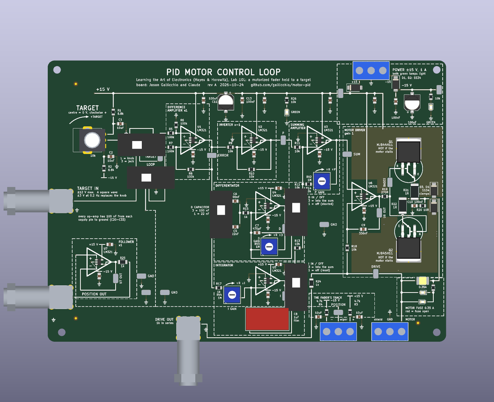

# PID Motor Control Loop — Lab 10L on one board

The motor-position feedback loop of *Learning the Art of Electronics* (Hayes &
Horowitz), Lab 10L, as a 170 x 120 mm printed circuit board whose silkscreen *is*
the schematic.  A motorized slide fader (the lab's Bourns PSM01-082A-103B2, or
any 100 mm fader with a 10k track and a 6–11 V motor) wires to two screw terminals; the
board holds the fader's wiper at the position a knob or a signal generator asks
for, with proportional, derivative and integral terms the student switches in
and turns up one at a time, exactly as the lab does.



Every node the lab asks you to look at has a probe loop (17 probe loops, four
of them ground).  Every stage sits in a dashed box named as the book names it.
The three gain trimmers are labelled P GAIN, D GAIN and I GAIN, each with an arc
over it saying what clockwise does (more resistance: more P, more D, less I);
the switches say in words what each position does.

## What is on it

| block | the book | here |
|---|---|---|
| TARGET | a 10k pot between ±15 V through 6.8k | a knob with a centre detent (0 V, clockwise positive), or a BNC jack for a slow square wave; a switch picks |
| pseudo op-amp | unity difference amplifier, inverter, summing amplifier | U1, U2, U3 (LM321) with 100k and 10k as drawn; the summing amplifier's gain is the P GAIN trimmer |
| derivative | C and 1k into an op-amp with 1M feedback, 470 pF across it | U4; a switch picks 22 nF (right for this fader) or the book's 100 nF; D IN / OFF switch |
| integral | 1k + 1M into an op-amp with a capacitor across it | U5 with a 1 µF polypropylene film (its value holds at any voltage); I IN / OFF, where OFF shorts the capacitor so the integrator starts from zero |
| motor driver | op-amp driving a push-pull pair, 10k feedback from the motor side, 0.33 µF from the op-amp's own output, 270 Ω into the bases, 10 Ω + 0.1 µF snubber | U6 with MJB44H11 / MJB45H11 in D2PAK, each in a 2 oz copper pour that is its heatsink, clamp diodes to the rails, a 0.35 A resettable fuse between the push-pull and DRIVE, with red lamps across it: the feedback, every probe loop and the motor are behind it |
| the plant | the fader's motor and 10k track with 4.7k end resistors (±7.7 V) | two 3-way screw terminals, MOTOR and POT, a POSITION probe loop and a buffered POSITION OUT jack |
| LOOP switch | the book's "break the loop here" | open (POSITION replaced by ground) or closed |

The design departs from the book where the parts or the pedagogy asked for it;
each departure is in [docs/DESIGN_NOTES.md](docs/DESIGN_NOTES.md).

## Using it

[docs/HANDBOOK.md](docs/HANDBOOK.md): bring-up without the fader, wiring the
fader and checking its polarity, the expected voltage at every loop, and the
lab's exercises in the lab's order (P alone and the residual error, raising the
gain until it oscillates, adding D, then I, then driving it with a square
wave).  The back of the board carries the short version.

## Ordering it

[docs/MANUFACTURING.md](docs/MANUFACTURING.md) is generated by the build: the
files to upload, JLCPCB's order form field by field, the cost, and what to look
at in their placement preview.  There are about $12.12 in parts per board.
Order **2 oz** outer copper, not the default 1 oz: the copper round the two
power transistors is their heatsink.

## Building it

```
./make.py
```

runs, from `scripts/parts.py` outward: the footprints and 3D stand-ins, the
ngspice simulation of the loop (from the exported netlist, with a model of the
fader), the schematic (`scripts/gen_sch.py`) and its ERC, 252 circuit
assertions on the netlist (`scripts/check_circuit.py`), the board
(`scripts/layout.py` placed and wired by `scripts/gen_pcb.py`, where every
drawn wire is laid as copper) and its DRC with schematic parity, the fab
package and its checks (`scripts/check_outputs.py`), and the documents, whose
every quoted number is checked against the build.  KiCad 10 is needed; the
build finds its AppImage.

## Files

- `hardware/` — the KiCad project (generated; do not edit by hand)
- `scripts/` — the generators and checkers
- `sim/` — the simulation and its results
- `out/motorpid/` — gerbers, BOM, CPL, prints, assembly notes
- `docs/` — handbook, design notes, manufacturing, images
- `CLAUDE_CODE_CHAT.md` — how this was designed, prompt by prompt

## Licence

Hardware under CERN-OHL-P v2 (`LICENSE-HARDWARE.txt`), scripts under MIT
(`LICENSE`).  The circuit is Hayes & Horowitz's; the board is Jason Gallicchio
and Claude, 2026.
